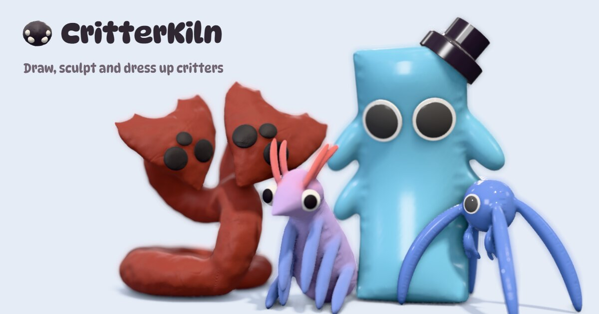
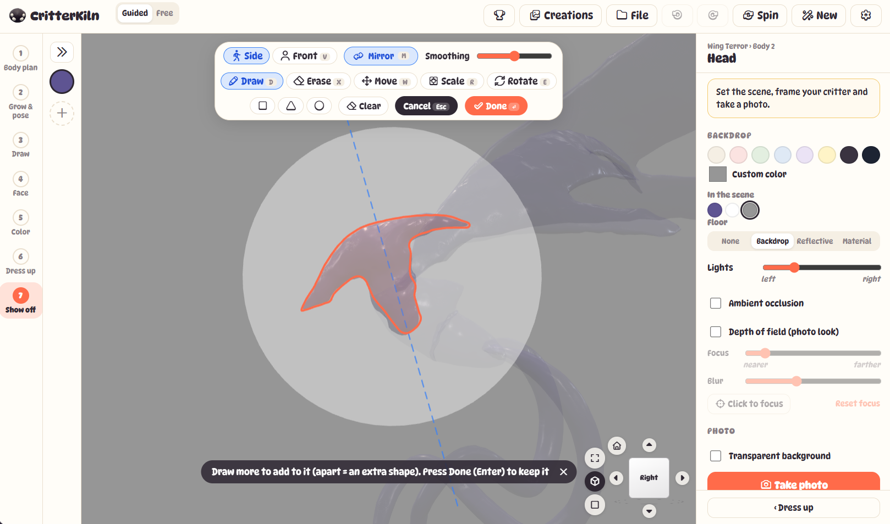
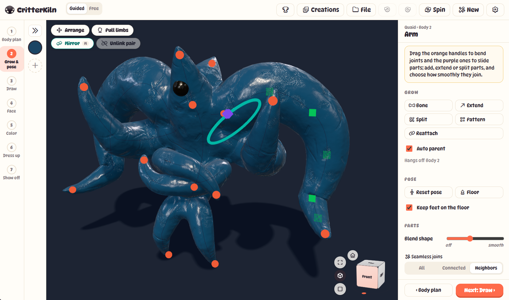
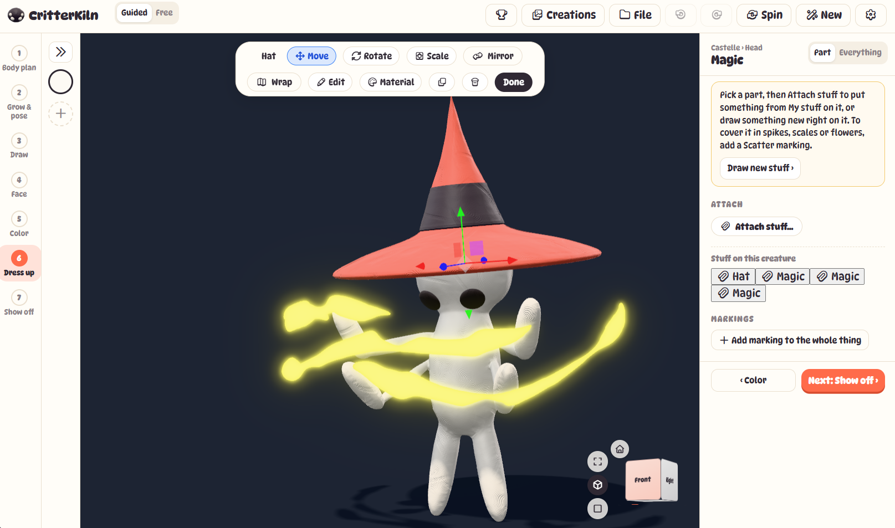
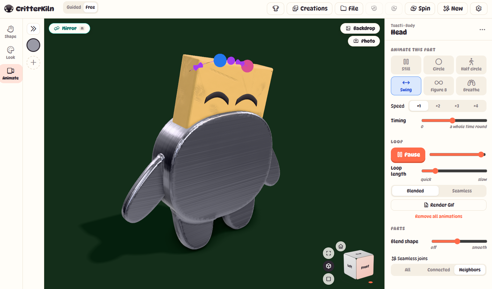

# CritterKiln

Draw a shape and it puffs up into a soft 3D critter. Sculpt it, pose it, give it eyes, colors and a hat, then make it move. Free, in your browser.

**[Open CritterKiln →](https://evajurman.github.io/critterkiln/)**

## Draw it

Pick a part and draw its outline. It puffs up like a balloon. On a middle part, draw one half and it mirrors to the other side.



## Grow and pose it

Start from a body plan, then add, extend or split parts. Drag the orange handles to bend joints and the purple ones to slide parts. Joins between parts smooth over on their own.



## Dress it up

Choose colors and materials (clay, felt, toy, glass, knitted, stone, metal and more), add markings like spots and stripes, give it eyes, and attach stuff like hats.



## Make it move

Give any part a looping motion (circle, step, swing, figure 8, breathe) and drag its path right in the view. Export the loop as a GIF.



## Two ways to work

- **Guided** walks you through seven steps: Body plan, Grow & pose, Draw, Face, Color, Dress up, Show off.
- **Free** opens everything at once in three tabs: Shape, Look and Animate.

Your creations save in the browser. Use **File** to save or open `.creature` files and share them. The app works on phones and offline too.

## Run it locally

You need [Node.js](https://nodejs.org/) 22 or newer.

```sh
npm install
npm run dev      # http://localhost:5173
npm run build    # type-check and build into dist/
```

Built with [three.js](https://threejs.org/), TypeScript and Vite. Every push to `main` deploys to GitHub Pages.
